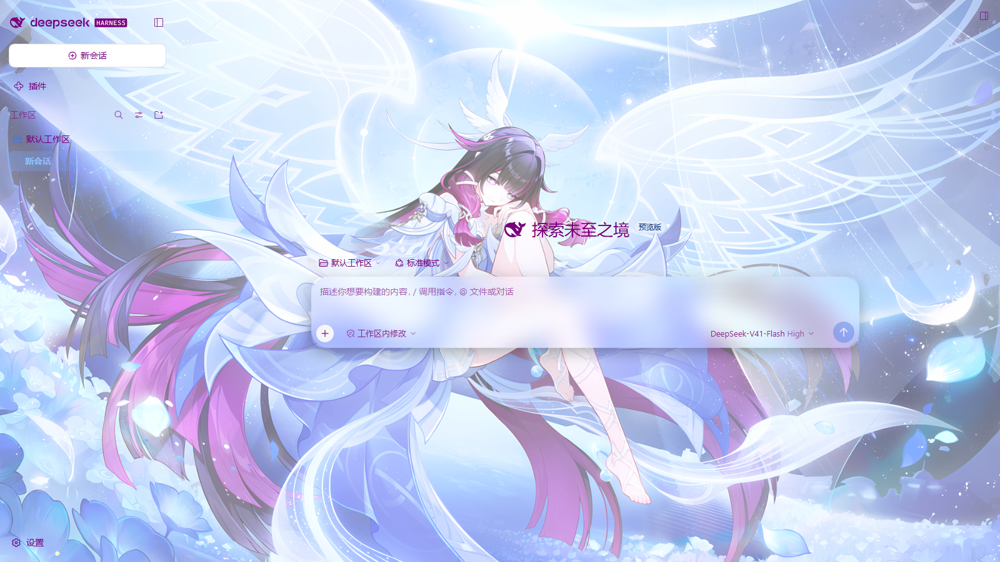
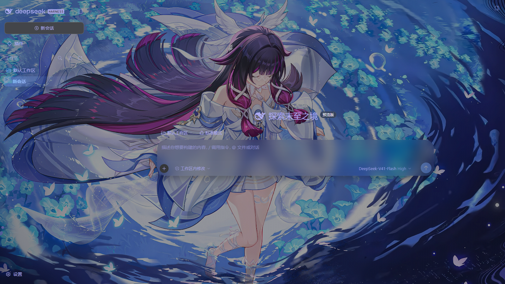

<div align="center">

# DSH 哥伦比娅主题 🕊️

**为 [DeepSeek Harness](https://github.com/deepseek-ai/deepseek-harness) Web / 桌面端打造的原神角色「哥伦比娅」主题插件。**

背景、蒙版、配色——来自挪德卡莱的月光。

</div>

## 特性

- **浅色 / 深色双默认**：浅色模式默认背景 `columbina-1` + 浅色配色（字体 `#78007a`、输入框 `#c8d1fe`、侧边栏 `#e5eaff`）；深色模式默认背景 `columbina-2` + 深色配色（字体 `#acabf2`、输入框/侧边栏 `#140010`）。切换明暗模式时背景与配色一起切换。
- **可调蒙版**：0% = 背景原图效果（主界面面板通透度同步归零），越高越不透明，100% = 完全覆盖为当前明暗主题底色。
- **自定义颜色**：蒙版、输入框、侧边栏、字体颜色均可自定义（留空 = 跟随明暗主题默认色）。
- **自定义背景**：上传 PNG / JPEG / WebP / GIF 图片作为背景；放进 `assets/backgrounds/` 的任意图片自动成为预设。
- **选中会话标题特效**：当前会话标题使用蓝紫渐变文字与光晕。
- **通透的界面表面**：会话区、气泡等主内容表面的通透度跟随蒙版设置；侧边栏与内容区同材质；设置面板、菜单、对话框等浮层始终不透明，保证可读性。
- **整窗同一块材质**：抹平宿主原本分给会话列、内容框、右侧面板的几层不透明底色与边界线，壁纸从侧栏贯通到内容区；标题栏与底部状态区一并透明，界面不再被切成「左一块、右一块」。
- **玻璃化消息面板**：用户气泡与助手消息块套同一套玻璃容器（模糊 + 淡蒙版），压在壁纸上文字依然清晰；面板浓度可在设置里单独调，0% 时模糊与描边一起归零。
- **聊天框效果**：液态玻璃（强模糊 + 高饱和）/ 高斯模糊（静态模糊，更省资源）两档可选，作用于消息面板、提问卡片与输入框玻璃。
- **首帧即生效（浏览器 / 桌面端）**：主题以结构化 index 注入行（`webserver/index-inject`）提供；Web 端随每次 index.html 响应渲染，桌面端随 Electron 的本地 index 启动载荷应用，加载无闪烁。
- **桌面端壁纸图层**：桌面窗口不经过 `webServer.tapIndex`，因此壁纸、蒙版与标题特效改由同一张注入表送达；同时覆盖 Windows 标题栏布局用侧边栏底色绘制整个 frame 的规则，避免不透明窗底色遮住壁纸。颜色、背景与明暗切换在桌面端同样生效。

## 效果预览

| 浅色模式 | 深色模式 |
| --- | --- |
|  |  |

## 兼容性

针对 **DeepSeek Harness `0.2.1-rc.2`**（`0.2.x` 系列）开发：`@deepseek-ai/cordis ^4.0.5`、`dsh-* ^0.2.0-rc.1`（已在 `0.2.1-rc.2` 的 Web 与 Desktop 两端验证）。设置改用 DSH 0.2 的插件 Config / settings forms 模型（volatile 字段热更新），不再依赖已删除的 `ctx.settings.register` 与 `@deepseek-ai/dsh-client-ui-slots` 包。DSH 仍处于 developer preview 阶段，接口可能发生破坏性变更；升级 DSH 后如发现主题失效，请先查看 [CHANGELOG](CHANGELOG.md) 与仓库的 release 说明。

## 安装

前置条件：DeepSeek Harness（`dsh`）、Node.js ≥ 22、pnpm 在 PATH。

### 1. 完全退出 DSH

先关闭 DSH Host（不只是关闭浏览器标签页）。

### 2. 安装插件

从 GitHub / npm（发布后）：

```powershell
dsh plugin --profile web add github:hyposelen1a/dsh-columbina-theme
# 或发布到 npm 后：
dsh plugin --profile web add dsh-columbina-theme
```

本地开发调试（link 方式，路径换成你的实际目录）：

```powershell
dsh plugin --profile web add link:/path/to/dsh-columbina-theme
```

也可以手动编辑 `$DSH_HOME/profiles/web/package.json`，把 `dsh-columbina-theme` 加入 `dependencies` 和 `dsh.profile.bundles`，然后在该目录执行 `pnpm install`。

> Desktop 桌面版（`DSH_PROFILE=desktop`）把上面命令里的 `--profile web` 换成 `--profile desktop`。

### 3. 重启 DSH

重新启动 `dsh web`（或桌面端 DSH），并**硬刷新浏览器**（Ctrl+F5；桌面端会重新加载本地 index）。打开 **设置 → 内置插件 → 哥伦比娅主题**，或在 **插件** 页打开 `dsh-columbina-theme` 的详情页，即可配置。

### 临时禁用

不用卸载，编辑 `$DSH_HOME/profiles/<profile>/cordis.patch.yml` 加两行并重启：

```yaml
- id: dsh-columbina-theme
  disabled: true
```

删除这两行（或改回 `false`）并重启，即可恢复启用。

## 使用

设置入口（三个等价位置）：

- **设置 → 通用 → 哥伦比娅主题**（推荐，完整设置卡片）
- **设置 → 内置插件 → 哥伦比娅主题**
- **插件 → dsh-columbina-theme**（插件详情页，DSH 自动配置表单）

| 设置项 | 说明 |
| --- | --- |
| 背景预设 | 预设网格（随包附带的 columbina-1/2 + 你放进 `assets/backgrounds/` 的图片）；留空 = 自动（浅色 columbina-1 / 深色 columbina-2），再点一次当前项可恢复自动 |
| 上传自定义图片 | 上传 PNG/JPEG/WebP/GIF（≤ 15MB），自动切换为自定义背景 |
| 蒙版不透明度 | 0% = 原图效果（面板通透度同步归零），越高越不透明，100% = 完全覆盖为当前明暗主题底色 |
| 字体颜色 | 默认跟随明暗配色；选择后同时用于两种配色 |
| 蒙版颜色 | 自定义蒙版底色（留空 = 跟随明暗主题） |
| 输入框颜色 | 自定义输入框颜色（留空 = 跟随明暗主题）；整窗材质启用后由材质层接管 |
| 侧边栏颜色 | 自定义侧边栏颜色（留空 = 跟随明暗主题）；整窗材质启用后由材质层接管 |
| 消息面板不透明度 | 用户气泡与助手消息块那层玻璃的浓度（0%–60%）；0% 时模糊与描边一起归零 |
| 输入框玻璃浓度 | 输入框那层玻璃比页面多压的深度（0%–100%）；0% 与页面同深、只剩模糊 |
| 聊天框效果 | 液态玻璃（强模糊 + 高饱和）/ 高斯模糊（静态模糊，更省资源）；作用于消息面板、提问卡片与输入框玻璃 |
| 选中会话标题特效 | 开关当前会话标题的渐变 + 光晕效果 |

设置保存在 `$DSH_HOME/profiles/<profile>/cordis.patch.yml` 中 `dsh-columbina-theme` 条目的 `config`（DSH 0.2 的插件配置层），修改后立即生效、无需重启。旧版本写在 `$DSH_HOME/settings.yaml` 的同名段落会在首次启动时自动迁移一次（仅当该条目尚未有用户配置时）。上传的自定义图片与预设缩略图缓存仍保存在 `$DSH_HOME/storages/dsh-columbina-theme/`。

### 添加自己的预设背景

把图片（`svg` / `png` / `jpg` / `jpeg` / `webp` / `gif`）放进插件的 `assets/backgrounds/` 目录，文件名只含字母、数字、`-`、`_`（如 `columbina-3.jpg`），重启 DSH 后自动出现在预设网格（id 用文件名，标签显示文件名），无需改代码。

> 位图（png/jpg/webp/gif）**超过 512KB** 时，设置网格自动使用服务端生成的预览缩略图（640px 宽 JPEG，缓存于 `$DSH_HOME/storages/dsh-columbina-theme/thumbs/`），点选作为背景时才加载原图；小图与 SVG 直接用原图。

## 开发

```text
src/index.js    Host 插件：导出 Config（全部字段 volatile）+ apply；
                通过 ctx.settings.describe/update 读写本插件条目的配置，
                config/上传端点、预设/缩略图/自定义图片静态路由；
                以 webserver/index-inject 结构化行提供壁纸/蒙版/标题样式
                （Web 端的 index.html 与桌面端本地 index 共用同一张注入表）
lib/client.js   浏览器 / 桌面端客户端插件：主题 token 覆盖（ctx.theme.overrideTokens）、
                --columbina-* 自定义属性、选中标题特效、设置卡片
                （注册到 settings.plugins.tab 与 plugins.bundle.config）
assets/backgrounds/  预设背景目录：放入图片即自动成为新预设
cordis.patch.yml     bundle 补丁（向组合中插入插件条目）
scripts/smoke-test.mjs   端到端冒烟测试（需要 playwright-core 与系统 Edge/Chrome）
scripts/screenshot.mjs   生成 README 截图
```

主题在两端各有一份取值表（host 的 `SCHEME_DEFAULTS`/`surfaceTokens`/`labelTokens` 与 client 的 `buildTokens`），两者必须保持一致——host 负责首帧静态注入（Web 与桌面端共用结构化注入行），client 负责运行期热更新（presenter 写入的 body 内联变量优先于静态样式表）。改动任何一边后重启 DSH Web 生效，并可用冒烟测试核对。

冒烟测试（需要 DSH 0.2 的已认证 URL；脚本会关闭首次启动的引导弹窗）：

```powershell
# 在临时 DSH_HOME 中创建一个测试 profile，并 link 本插件
$env:DSH_HOME = "C:\path\to\.e2e-home"
dsh --profile e2e --from-default-profile web --dump-config
dsh plugin --profile e2e add link:C:\path\to\dsh-columbina-theme
dsh --profile e2e --port 0 --no-open
# 把输出里的已认证 URL（含 ?token=…）传给脚本
$env:E2E_BASE = "http://127.0.0.1:<端口>/?token=<token>"
node scripts/smoke-test.mjs
```

## 已知限制

- 选中会话标题特效依赖会话行的 DOM 结构（`role="treeitem"` + 标题 span 的 `_title` 类后缀），DSH 界面内部类名随版本变化时可能需要调整选择器。
- 桌面端壁纸依赖 Windows 标题栏布局的 `[class$="_frame"]`（哈希类名）与 `data-windows-titlebar` 属性；DSH 调整该布局时可能需要同步更新这两条选择器。
- 表面透明度通过 CSS token 覆盖实现，DSH 版本升级后个别表面可能不再受控。
- 整窗材质层依赖若干哈希类名（`_sidebarCol`、`_centerCol`、`_rightbarCol`、`_composerSeat`、`_userRow`/`_bubble`）与 `[data-slot="conversation.composer.bar"]` 这类数据槽位；DSH 调整 DOM 结构时，相应地板的透明化会失效（表现为某一块重新出现底色），需要同步更新选择器。
- 整窗材质需要把 `--dsw-specific-input-major`、`--dsw-specific-sidebar-fill`、`--dsw-alias-bg-base` 三个 token 归零，因此「输入框颜色」「侧边栏颜色」两项在启用后不再产生可见效果（配置值仍会保存，仅被材质层覆盖）。
- 设置写入使用 DSH 的 settings forms（profile patch 层）；多实例共享同一 profile 时，并发写入以最后一次为准。

## 素材版权说明

- 代码与程序生成的预设资源采用 [MIT](LICENSE) 许可。
- 随包附带的两张背景图 `columbina-1.png` / `columbina-2.png` 为**作者自备素材，版权归原作者所有**；若涉及米哈游《原神》官方素材或他人同人作品，请勿随仓库公开分发，或替换为你自己的原创图片后再发布（放进 `assets/backgrounds/` 即可，无需改代码）。详见 [ASSET_LICENSE.md](ASSET_LICENSE.md)。

## 许可

MIT License。
